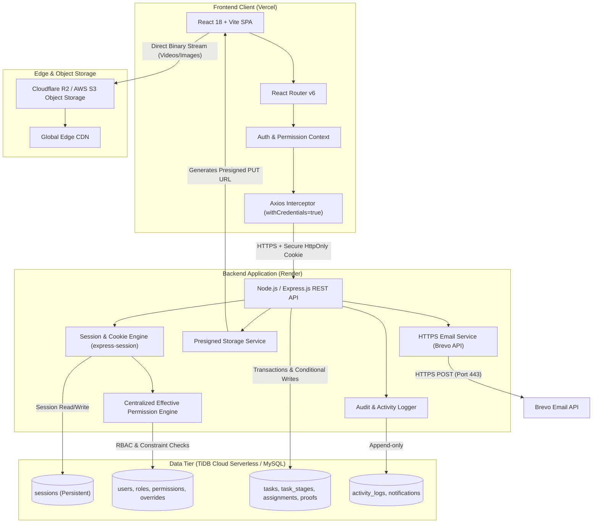
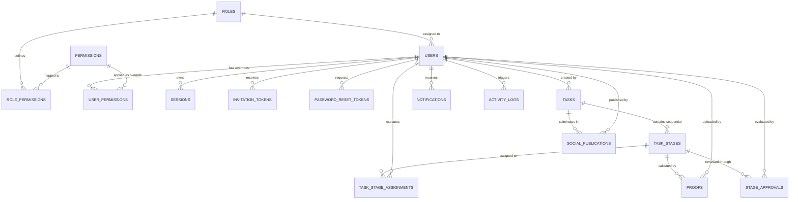
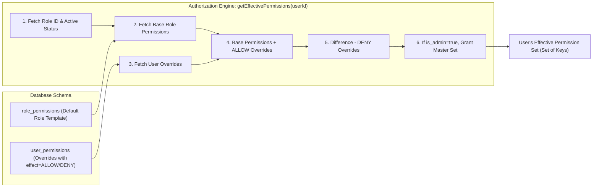
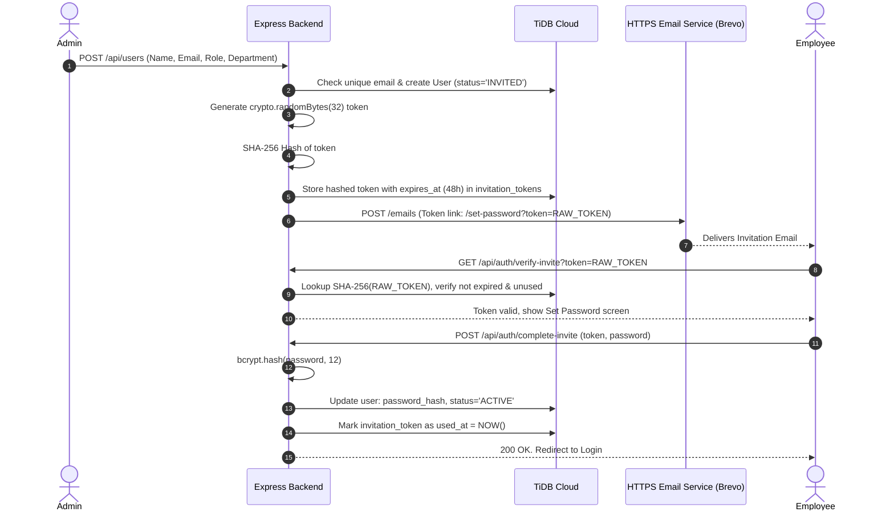
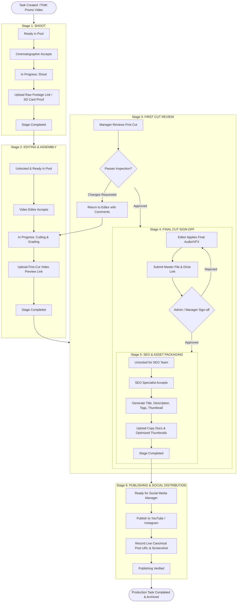
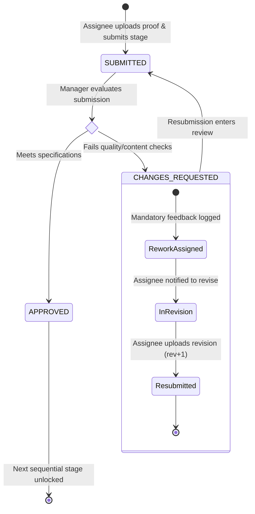
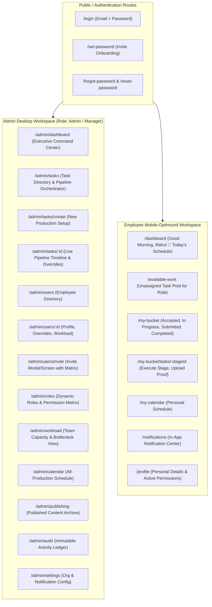

# Digital Marketing Team HRMS & Content Production Management System
## STAGE 0: ARCHITECTURAL SPECIFICATION & SYSTEM DESIGN BLUEPRINT

---

### EXECUTIVE ARCHITECTURAL SUMMARY & PROBLEM RESOLUTION
The primary objective of this system is to eliminate the fragmented, error-prone operations of digital marketing content production (traditionally handled via chaotic WhatsApp groups, untracked Google Sheets, and manual follow-ups) and replace them with a unified, deterministic, role-and-permission-driven Content Production Workflow Engine.

Unlike generic HRMS platforms that treat employees solely as static records (leaves, payroll, timesheets), **this system treats the Content Production Pipeline as the central business entity**. Employees, dynamic roles, granular permissions, stage transitions, digital proof verification, and social publishing are all coordinated around this pipeline.

---

## TABLE OF CONTENTS
- [A. Complete Requirement Specification](#a-complete-requirement-specification)
- [B. System Architecture](#b-system-architecture)
- [C. Database ERD (Entity-Relationship Diagram)](#c-database-erd)
- [D. Complete Permission Catalog](#d-complete-permission-catalog)
- [E. Role → Permission Matrix](#e-role--permission-matrix)
- [F. User → Permission Override Architecture](#f-user--permission-override-architecture)
- [G. Authentication & Session Architecture](#g-authentication--session-architecture)
- [H. Production Workflow Diagram & Stage Progression](#h-production-workflow-diagram)
- [I. Task Lifecycle State Machine](#i-task-lifecycle)
- [J. Assignment Lifecycle & Concurrency Locking](#j-assignment-lifecycle)
- [K. Proof Lifecycle & Asset Handling](#k-proof-lifecycle)
- [L. Approval & Rework Lifecycle](#l-approval--rework-lifecycle)
- [M. Screen & Page Map (Admin vs. Employee)](#m-screen--page-map)
- [N. Modular REST API Endpoint Map](#n-modular-rest-api-endpoint-map)
- [O. Complete Database Table Specification (DDL)](#o-database-table-specification)
- [P. Security Model & Threat Mitigation](#p-security-model)
- [Q. Deployment & Infrastructure Architecture](#q-deployment-architecture)
- [R. MVP vs. Future Feature Separation](#r-mvp-vs-future-feature-separation)

---

## A. COMPLETE REQUIREMENT SPECIFICATION

### 1. Functional Requirements

#### 1.1 Organizational & User Management
- **Hierarchical Governance:** Admin root account with non-revocable safety mechanisms. Ability to create, update, suspend, and view employees.
- **Invitation-Based Onboarding:** No manual temporary passwords. Admin initiates onboarding with Name, Email, Role, Department; system issues a cryptographically signed, single-use, 48-hour invitation token delivered via HTTPS email.
- **Profile Management:** Avatar/headshot upload, contact phone, department, assigned role, active task capacity counters.

#### 1.2 Dynamic RBAC & Permission Overrides
- **Dynamic Roles:** System ships with default roles (`Admin`, `Cinematographer`, `Photographer`, `Editor`, `SEO Specialist`, `Graphic Designer`, `Content Creator`, `Social Media Manager`, `Production Manager`), but allows Admins to create, clone, update, or deactivate custom roles.
- **Atomic Permission Catalog:** 45+ granular permissions grouped into logical functional domains.
- **Three-Tier Effective Permission Evaluation:**
  $$\text{Effective Permissions} = (\text{Role Permissions} \cup \text{User ALLOW Overrides}) \setminus \text{User DENY Overrides}$$
- **Admin Safeguard:** Protection against revoking the last Admin's permissions or disabling the primary Admin account.

#### 1.3 Content Production & Stage Engine
- **Task Conception:** Production Tasks encapsulate course/campaign metadata, priority, scheduled shoot times, duration, location, target role, and stage blueprint.
- **Separation of Concerns:** Distinct separation between global **Task Status** (`SCHEDULED`, `AVAILABLE`, `ASSIGNED`, `IN_PROGRESS`, `UNDER_REVIEW`, `COMPLETED`, `CANCELLED`, `DELAYED`) and individual **Stage State** (`PENDING`, `READY`, `IN_PROGRESS`, `SUBMITTED`, `CHANGES_REQUESTED`, `APPROVED`, `SKIPPED`).
- **Sequential Pipeline Progression:** Production follows an automated dependency chain:
  `Shoot` $\rightarrow$ `Raw Footage Delivery` $\rightarrow$ `Editing` $\rightarrow$ `First Cut Review` $\rightarrow$ `Final Cut Approval` $\rightarrow$ `SEO Optimization` $\rightarrow$ `Publishing & Social Link Archival`.
- **Automatic Stage Unlocking:** When a stage is completed and approved, the downstream stage automatically transitions from `PENDING` to `READY` and appears in the task pool of eligible employees.

#### 1.4 Work Distribution & Concurrency Guard
- **Self-Serve Work Pool ("Available Tasks"):** Unassigned tasks/stages matching an employee's role and capability are visible in their Available feed.
- **Double-Acceptance Prevention:** Strict atomic locking at the database level prevents two employees clicking "Accept" simultaneously from receiving duplicate assignments.
- **Personal Work Bucket:** Dedicated workspace for accepted assignments categorised by timeline (`Today`, `Upcoming`, `In Progress`, `Overdue`).

#### 1.5 Verification, Proof & Rework Loops
- **Proof of Action Requirement:** Stages cannot be closed without verified proof. Supports multiple proof modalities: direct file upload (images, docs), cloud drive links (Google Drive / Frame.io for 4K video), or live publication URLs with screenshots.
- **Formal Review Gateways:** Designated gatekeeper stages (e.g., `First Cut Review`, `Final Cut Approval`) allow Managers/Admins to either `APPROVE` or `REQUEST CHANGES` with structured timestamps and feedback comments.
- **Revision Tracking:** Rework loops increment revision numbers (`rev_1`, `rev_2`) rather than discarding historical records.

#### 1.6 Publishing & Social Distribution
- **Publishing Metadata:** Capture platform (YouTube, Instagram, LinkedIn, Facebook, X, Website), live canonical post URL, publishing timestamp, publisher identity, caption, and verification screenshot.

#### 1.7 Transparency, Auditing & Notification
- **In-App Notification Center:** Real-time bell alerts for assignments, approvals, stage unlocks, and deadline alerts with read/unread tracking.
- **System Activity & Audit Ledger:** Immutable audit trail recording Actor, Action, Entity, Entity ID, Changes (Diff), IP, and Timestamp.

### 2. Non-Functional Requirements
- **Performance & Cold-Start Resilience:** Initial API response $< 300\text{ ms}$ (warm) and graceful UI loading skeletons during Render free-tier cold starts ($\sim 30\text{ s}$).
- **Database Scalability:** TiDB/MySQL relational integrity with ACID transactions, indexed foreign keys, and sub-100ms queries for dashboard telemetry.
- **Zero In-Memory Session Loss:** Express sessions backed by database storage so server restarts do not disconnect active users.
- **Direct-to-Storage Video Handling:** Large binary assets bypass the Express application server directly to Cloudflare R2 / AWS S3 via presigned PUT URLs, preventing RAM spikes and request timeouts.

---

## B. SYSTEM ARCHITECTURE



---

## C. DATABASE ERD (ENTITY-RELATIONSHIP DIAGRAM)



---

## D. COMPLETE PERMISSION CATALOG

The application features **46 atomic permissions** organized into **11 administrative and operational domains**. Permissions follow the `resource.action` notation.

| Domain | Permission Key | Human Name | Description |
| :--- | :--- | :--- | :--- |
| **User Mgmt** | `users.view` | View Users | View employee directory, basic details, and status |
| | `users.create` | Invite/Create User | Send invitation emails to onboard new employees |
| | `users.edit` | Edit User Details | Update employee profile, department, and phone |
| | `users.disable` | Deactivate/Enable User | Toggle account active/suspended state |
| | `users.delete` | Delete User | Permanently remove inactive accounts with no task history |
| **Role Mgmt** | `roles.view` | View Roles | Inspect role definitions and default permission sets |
| | `roles.create` | Create Role | Define new custom organizational roles |
| | `roles.edit` | Edit Role | Modify role descriptions and default permission sets |
| | `roles.delete` | Delete Role | Delete custom roles not currently assigned to users |
| **Permission Mgmt** | `permissions.view` | View Permissions | View catalog of system permissions and dependencies |
| | `permissions.override`| Manage User Overrides | Apply ALLOW/DENY permission overrides to specific users |
| **Task Mgmt** | `tasks.view` | View Tasks | View production tasks in the general directory |
| | `tasks.create` | Create Task | Initialize and configure new production tasks |
| | `tasks.edit` | Edit Task | Update title, course, priority, date, or target role |
| | `tasks.delete` | Cancel/Delete Task | Cancel or delete tasks before active execution starts |
| | `tasks.assign` | Direct Task Assign | Assign/dispatch a task stage directly to a specific user |
| | `tasks.reassign` | Reassign Task | Revoke current assignee and reassign to another worker |
| **Work Execution** | `work.pool_view` | View Available Work | Browse unassigned tasks in the Available Work Pool |
| | `work.accept` | Accept Work | Claim and self-assign an available stage into My Bucket |
| | `work.reject` | Decline/Release Work | Relinquish an accepted task back to the available pool |
| | `work.start` | Start Work Stage | Transition a stage from ACCEPTED to IN_PROGRESS |
| | `work.complete` | Complete Work Stage | Submit finished stage work with required proof |
| **Production Pipeline**| `production.view_all` | View All Pipelines | Inspect end-to-end production pipelines across all roles |
| | `production.manage` | Manage Pipeline | Reorder stages, insert custom stages, or bypass stages |
| | `production.rollback` | Rollback Stage | Manually revert a stage to an earlier state |
| **Proof & Assets** | `proof.view` | View Proofs | Inspect uploaded raw files, review cuts, and links |
| | `proof.upload` | Upload Proof | Submit video links, photos, or documents as stage proof |
| | `proof.delete` | Remove Proof | Delete mistakenly uploaded proof files prior to approval |
| **Review & Approval**| `approval.review` | Review Stage Work | Evaluate submitted proof for First Cut / Final Cut |
| | `approval.approve` | Approve Stage | Grant formal sign-off to proceed to next stage |
| | `approval.reject` | Request Rework | Reject submitted cut with mandatory feedback notes |
| **Social Publishing**| `publishing.view` | View Published Logs | Inspect archive of published posts and live URLs |
| | `publishing.publish` | Record Publication | Submit final post URL, platform, and screenshot proof |
| | `publishing.manage` | Edit Publication Meta | Update social platform links or publication tags |
| **Calendar & Scheduling**| `calendar.view_own`| View Own Calendar | Access personal scheduled timeline |
| | `calendar.view_all`| View All Calendars | Access high-level team schedule and studio shoots |
| | `calendar.manage` | Manage Calendar | Reschedule shooting blocks and adjust time allocations |
| **Workload & Team** | `workload.view_all`| View Team Workload | Inspect task load, active counts, and bottleneck metrics |
| **Analytics & Reports**| `analytics.view` | View Dashboard Stats| Access production KPI counters and stage metrics |
| | `reports.view` | View Reports | Access deep-dive productivity and duration reports |
| | `reports.export` | Export Reports | Export CSV/PDF dumps of production history |
| **Audit & Governance**| `audit.view` | View Audit Logs | Inspect immutable system-wide activity and security logs |
| **System Settings** | `settings.view` | View System Settings| Inspect storage, email, and company configurations |
| | `settings.manage` | Update Settings | Modify platform parameters and notification thresholds |

---

## E. ROLE → PERMISSION MATRIX

The initial system configuration provisions 9 core roles mapped to appropriate permission baselines.

| Permission Key | Admin | Cinematographer | Photographer | Video Editor | SEO Spec | Graphic Designer | Content Creator | Social Media Mgr | Production Mgr |
| :--- | :---: | :---: | :---: | :---: | :---: | :---: | :---: | :---: | :---: |
| `users.*` (view/create/edit/disable/del) | **ALL** | — | — | — | — | — | — | — | view only |
| `roles.*` & `permissions.*` | **ALL** | — | — | — | — | — | — | — | — |
| `tasks.view` | **YES** | **YES** | **YES** | **YES** | **YES** | **YES** | **YES** | **YES** | **YES** |
| `tasks.create` | **YES** | — | — | — | — | — | **YES** | — | **YES** |
| `tasks.edit` | **YES** | — | — | — | — | — | — | — | **YES** |
| `tasks.delete` | **YES** | — | — | — | — | — | — | — | — |
| `tasks.assign` / `tasks.reassign` | **YES** | — | — | — | — | — | — | — | **YES** |
| `work.pool_view` / `work.accept` | **YES** | **YES** | **YES** | **YES** | **YES** | **YES** | **YES** | **YES** | **YES** |
| `work.reject` / `work.start` / `complete`| **YES** | **YES** | **YES** | **YES** | **YES** | **YES** | **YES** | **YES** | **YES** |
| `production.view_all` | **YES** | — | — | — | — | — | — | **YES** | **YES** |
| `production.manage` / `rollback` | **YES** | — | — | — | — | — | — | — | **YES** |
| `proof.view` | **YES** | **YES** | **YES** | **YES** | **YES** | **YES** | **YES** | **YES** | **YES** |
| `proof.upload` | **YES** | **YES** | **YES** | **YES** | **YES** | **YES** | **YES** | **YES** | **YES** |
| `proof.delete` | **YES** | (own) | (own) | (own) | (own) | (own) | (own) | (own) | **YES** |
| `approval.review` / `approve` / `reject`| **YES** | — | — | — | — | — | — | **YES** | **YES** |
| `publishing.view` | **YES** | — | — | — | **YES** | — | — | **YES** | **YES** |
| `publishing.publish` / `manage` | **YES** | — | — | — | **YES** | — | — | **YES** | **YES** |
| `calendar.view_own` | **YES** | **YES** | **YES** | **YES** | **YES** | **YES** | **YES** | **YES** | **YES** |
| `calendar.view_all` / `manage` | **YES** | — | — | — | — | — | — | view only | **YES** |
| `workload.view_all` | **YES** | — | — | — | — | — | — | **YES** | **YES** |
| `analytics.view` / `reports.*` | **YES** | — | — | — | — | — | — | view only | **YES** |
| `audit.view` | **YES** | — | — | — | — | — | — | — | view only |
| `settings.*` | **YES** | — | — | — | — | — | — | — | — |

---

## F. USER → PERMISSION OVERRIDE ARCHITECTURE

### 1. The Core Authorization Formula
$$\text{Effective Permissions} = (\text{Role Permissions} \cup \text{User ALLOW Overrides}) \setminus \text{User DENY Overrides}$$



---

## G. AUTHENTICATION & SESSION ARCHITECTURE

### 1. Invitation & Onboarding Sequence


---

## H. PRODUCTION WORKFLOW DIAGRAM & STAGE PROGRESSION



---

## I. TASK LIFECYCLE (GLOBAL STATE MACHINE)

```mermaid
stateDiagram-v2
    [*] --> SCHEDULED: Admin schedules future task
    [*] --> AVAILABLE: Admin publishes task immediate for pickup
    
    SCHEDULED --> AVAILABLE: Scheduled date/time reached
    SCHEDULED --> CANCELLED: Admin cancels before kickoff
    
    AVAILABLE --> IN_PROGRESS: Primary/first stage accepted & begun
    AVAILABLE --> CANCELLED: Cancelled
    
    IN_PROGRESS --> UNDER_REVIEW: Intermediate stage awaits review
    UNDER_REVIEW --> IN_PROGRESS: Changes requested (rework)
    UNDER_REVIEW --> IN_PROGRESS: Review approved, next stage begins
    
    IN_PROGRESS --> DELAYED: Deadline breached before final stage
    DELAYED --> IN_PROGRESS: Work resumed
    
    IN_PROGRESS --> COMPLETED: Final stage (Publishing) completed & verified
    DELAYED --> COMPLETED: Completed after deadline
    
    COMPLETED --> [*]
    CANCELLED --> [*]
```



---

## J. ASSIGNMENT LIFECYCLE & CONCURRENCY LOCKING

### TiDB / MySQL Atomic Resolution Strategy
```sql
START TRANSACTION;

-- 1. Atomic Conditional Update
UPDATE task_stages
SET 
    status = 'IN_PROGRESS',
    version = version + 1,
    updated_at = NOW()
WHERE 
    id = ? 
    AND status = 'READY'
    AND version = ?;

-- If affectedRows === 0:
--   ROLLBACK;
--   Return 409 Conflict: "This task has already been accepted by another employee."

-- 2. Insert Assignment Record
INSERT INTO task_stage_assignments (
    task_stage_id,
    user_id,
    assigned_by,
    assignment_type,
    status,
    accepted_at
) VALUES (?, ?, ?, 'SELF_CLAIM', 'ACCEPTED', NOW());

COMMIT;
```

---

## K. PROOF LIFECYCLE & ASSET HANDLING

```mermaid
sequenceDiagram
    autonumber
    actor Employee
    participant Client as React SPA
    participant Server as Express Backend
    participant Storage as Cloudflare R2 / S3
    participant DB as TiDB

    Employee->>Client: Selects file (e.g. first_cut.mp4, 85 MB)
    Client->>Server: POST /api/proofs/presign (stageId, filename, mimeType, size)
    Server->>Server: Validate user has work.complete or proof.upload on stage
    Server->>Storage: Generate S3 PutObjectCommand presigned URL (valid 15m)
    Storage-->>Server: Return presigned upload URL
    Server-->>Client: 200 OK: { uploadUrl, fileKey, publicUrl }
    Client->>Storage: PUT uploadUrl (Direct binary payload with Content-Type)
    Storage-->>Client: 200 OK
    Client->>Server: POST /api/proofs/confirm (stageId, fileKey, publicUrl, proofType)
    Server->>DB: INSERT INTO proofs (...); UPDATE task_stages SET status='SUBMITTED';
    Server-->>Client: 201 Created (Proof registered, stage advanced)
```

---

## L. APPROVAL & REWORK LIFECYCLE



---

## M. SCREEN & PAGE MAP (ADMIN VS. EMPLOYEE)



---

## N. MODULAR REST API ENDPOINT MAP

See Table in Section N of the master design document for the complete 40+ REST API endpoints partitioned across:
- `/api/auth`
- `/api/users`
- `/api/roles`
- `/api/permissions`
- `/api/tasks`
- `/api/production`
- `/api/work`
- `/api/proofs`
- `/api/approvals`
- `/api/publishing`
- `/api/calendar`
- `/api/analytics`
- `/api/audit`
- `/api/notifications`

---

## O. COMPLETE DATABASE TABLE SPECIFICATION (DDL)
14 normalized tables:
- `roles`
- `permissions`
- `role_permissions`
- `users`
- `user_permissions`
- `sessions`
- `invitation_tokens`
- `password_reset_tokens`
- `tasks`
- `task_stages`
- `task_stage_assignments`
- `proofs`
- `stage_approvals`
- `social_publications`
- `notifications`
- `activity_logs`

---

## P. SECURITY MODEL & THREAT MITIGATION
- **Session Hijacking:** Mitigated with strict `HttpOnly` cookie storage and server-side invalidation.
- **CSRF:** Mitigated via `SameSite` cookie policies and custom header verification.
- **IDOR / BOLA:** Mitigated via fine-grained resource-level ownership validation in controllers.
- **Double-Accept Race Conditions:** Mitigated using atomic database-level version updates.
- **Large Binary DoS:** Mitigated with direct-to-cloud presigned upload URLs (Cloudflare R2).
- **Admin Self-Lockout:** Hardcoded safety layer preventing self-revocation or deleting the root Admin account.

---

## Q. DEPLOYMENT & INFRASTRUCTURE ARCHITECTURE
- **Frontend:** React + Vite on Vercel CDN.
- **Backend:** Node.js + Express on Render Web Service.
- **Database:** TiDB Cloud Serverless (MySQL-compatible, persistent session store).
- **Object Storage:** Cloudflare R2 (10 GB free tier with zero egress costs).
- **Email:** Brevo HTTPS REST API (Port 443).

---

## R. MVP VS. FUTURE FEATURE SEPARATION
- **MVP Focus:** Core RBAC + Overrides, Invitation flow, Concurrency-safe self-claim work bucket, 6-stage content pipeline, Proof verification, Review/Approval loops, Social publication recording, Audit logs.
- **Post-MVP Focus:** Meta/Instagram Direct Graph API publishing, WebPush notifications, WhatsApp webhook bot, Two-Factor Authentication, AI production assistant.

